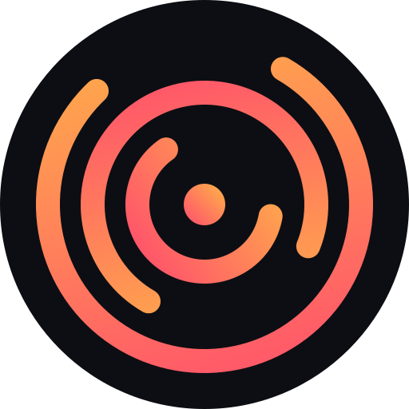
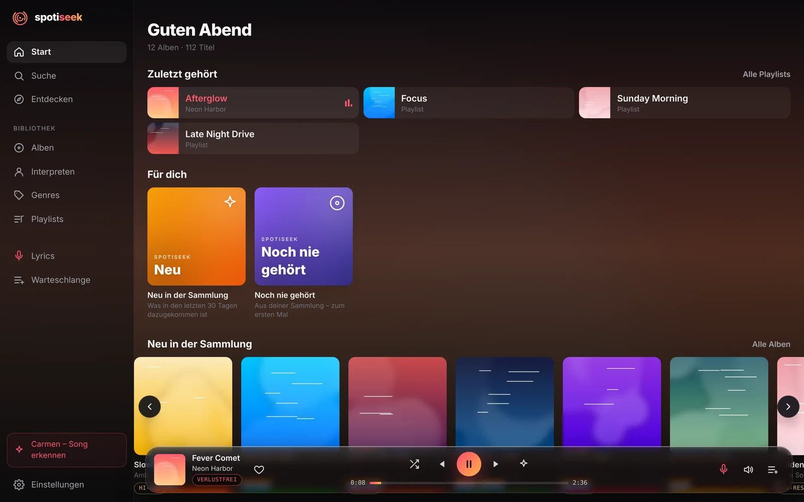
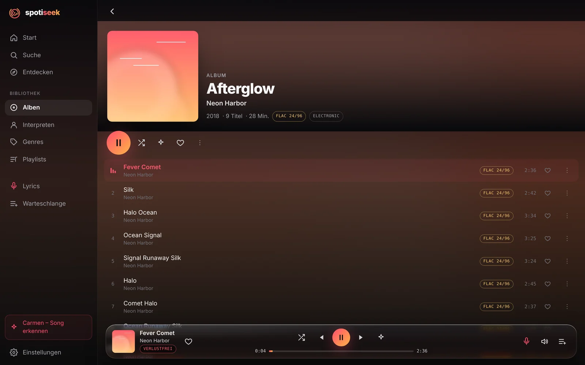
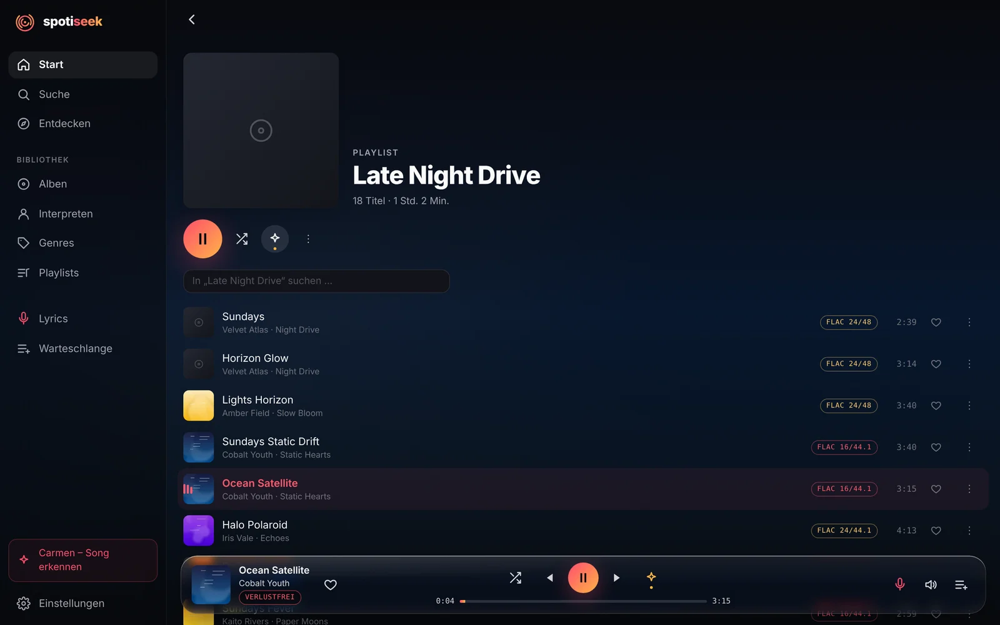
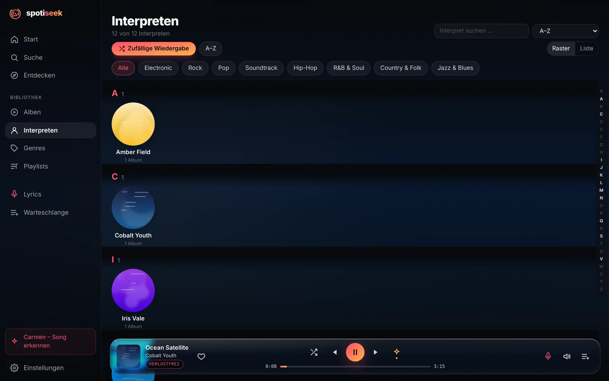
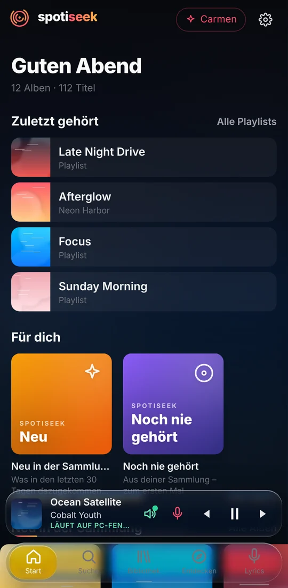
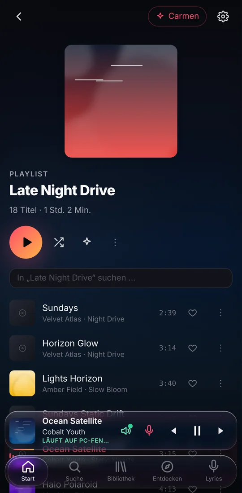

# spotiseek Player

**Deine eigene Musiksammlung – so bequem wie ein Streamingdienst, bitperfekt.**

Ein Musikplayer für Windows und Android, der die Dateien auf deinem PC so abspielt, wie Spotify seinen Katalog:
Startseite für dich, smarte Mixe, mitlaufende Lyrics und Connect, um zwischen PC und Handy zu wechseln.
Verlustfreie und Hi-Res-Dateien kommen unverändert beim DAC an.

[**Für Windows herunterladen**](https://github.com/mmmxcix/spotiseek-player/releases/latest/download/spotiseek-setup.exe) ·
[**Für Android herunterladen (APK)**](https://github.com/mmmxcix/spotiseek-player/releases/latest/download/spotiseek-player.apk) ·
[Alle Versionen](https://github.com/mmmxcix/spotiseek-player/releases) ·
[English](README.md)

## Screenshots

<table>
  <tr>
    <td width="50%"></td>
    <td width="50%"></td>
  </tr>
  <tr>
    <td></td>
    <td align="center">
      
      
    </td>
  </tr>
</table>

Die Screenshots zeigen eine Demo-Sammlung mit erfundenen Interpreten und erzeugten Covern.

## Funktionen

**Klang**
- **Bitperfekt unter Windows** – WASAPI exklusiv, am Windows-Mixer vorbei: jede Datei in ihrer eigenen Abtastrate und Bittiefe, bis 24 bit/192 kHz.
- **Bitperfekt unter Android** – direkt an einen USB-DAC, ohne das Umrechnen von Android.
- **Qualität auf einen Blick** – FLAC 16/44.1, 24/96, MP3 320 … bei jedem Titel und Album, Hi-Res-Abzeichen für Hi-Res-Alben.

**Deine Sammlung wie ein Streamingdienst**
- Alben, Interpreten und Genres mit Covern, Suche und Sortierung. Zusammenarbeiten erscheinen bei jedem beteiligten Interpreten.
- **Zuletzt gehört** auf der Startseite, Mixe **für dich** (Dauerschleife, Meistgehört, Dein Mix, Neu, Noch nie gehört) und ein **Wrapped** zum Jahresende.
- **Magic Shuffle** – mischt eine Playlist und streut passende Lieder aus deiner Sammlung ein.
- **Lyrics**, die mit der Musik mitlaufen, und ein Mitsing-Modus.
- Playlists als normale `.m3u8`-Dateien – andere Player sehen sie auch. Favoriten, Hörverlauf, Warteschlange.
- **Aufräumen** – findet doppelte Ausgaben (normal, Deluxe, CD 1/2) und führt sie zusammen, von jedem Lied bleibt die beste Datei.

**PC und Handy zusammen**
- **Connect** – wie Spotify Connect: wählen, wo die Musik läuft, den PC vom Handy aus steuern (auch über Sperrbildschirm und Benachrichtigung) oder das Handy vom PC aus, und die Wiedergabe an derselben Stelle mitnehmen.
- **Unterwegs hören** – deine Sammlung auch ausser Haus, über eine verschlüsselte Verbindung. Ohne Portfreigabe, ohne Konto.
- **Offline** – Alben und Playlists aufs Handy laden.
- Geräte mit einem kurzen Code verbinden; jedes Gerät bekommt einen eigenen Schlüssel und lässt sich wieder entfernen.

**Windows**
- Play/Pause und Weiter in der Vorschau der Taskleiste, Medientasten, echtes Vollbild.
- Aktualisiert sich selbst, wenn du gerade nichts machst.

## Installation

### Windows (10 / 11, 64 bit)

1. [`spotiseek-setup.exe`](https://github.com/mmmxcix/spotiseek-player/releases/latest/download/spotiseek-setup.exe) herunterladen und starten.
2. Das Installationsprogramm ist noch nicht signiert, Windows SmartScreen warnt deshalb evtl.: **Weitere Informationen → Trotzdem ausführen**.
3. Beim ersten Start den Musikordner wählen. spotiseek liest Tags und Cover, verschoben oder geändert wird nichts.

### Android

1. [`spotiseek-player.apk`](https://github.com/mmmxcix/spotiseek-player/releases/latest/download/spotiseek-player.apk) auf dem Handy herunterladen und öffnen.
2. Wenn Android fragt: dem Browser erlauben, Apps zu installieren.
3. Am PC **Einstellungen → Geräte → Neues Gerät verbinden** öffnen und den Code in der App eingeben.

Das Handy streamt vom PC, die PC-App muss also laufen. Zuhause klappt das im WLAN; mit **Unterwegs hören** in den Einstellungen am PC überall.

## Häufige Fragen

**Brauche ich ein Spotify-Konto oder ein Abo?**
Nein. spotiseek spielt Musikdateien, die du schon auf deinem PC hast.

**Wo liegen meine Daten?**
Auf deinem PC. Es gibt keine Cloud und kein Konto. Die einzige Verbindung nach aussen ist das freiwillige **Unterwegs hören** (Cloudflare-Tunnel), das sich abschalten lässt.

**Welche Formate gehen?**
FLAC, ALAC, WAV, AIFF, MP3, AAC/M4A, Ogg/Opus und mehr. Was das Handy nicht selbst abspielt, wandelt der PC unterwegs verlustfrei in FLAC um.

**Fehler gefunden oder eine Idee?**
Bitte ein [Issue](https://github.com/mmmxcix/spotiseek-player/issues) eröffnen – ein Screenshot hilft sehr.

---

Von <a href="https://mmmxcix.com">mmmxcix</a>

