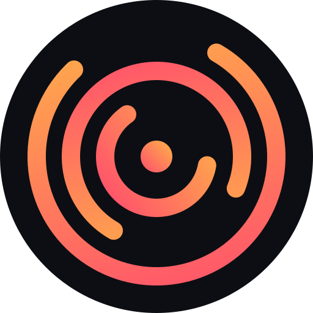
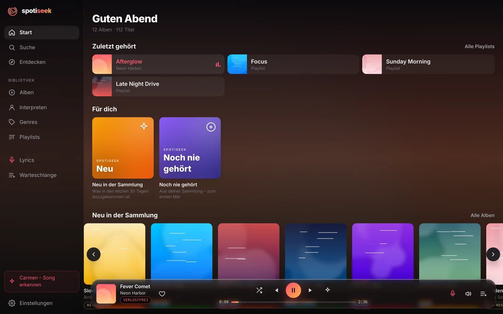
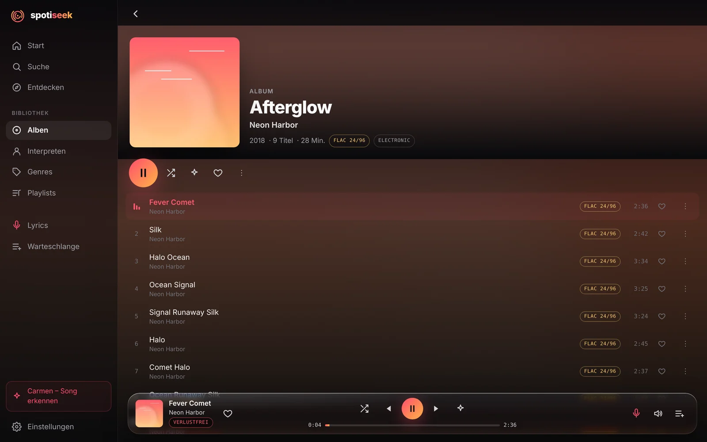
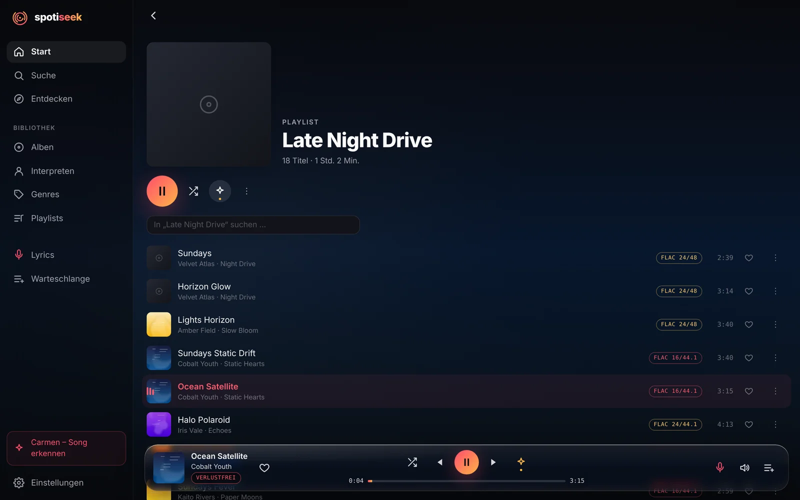
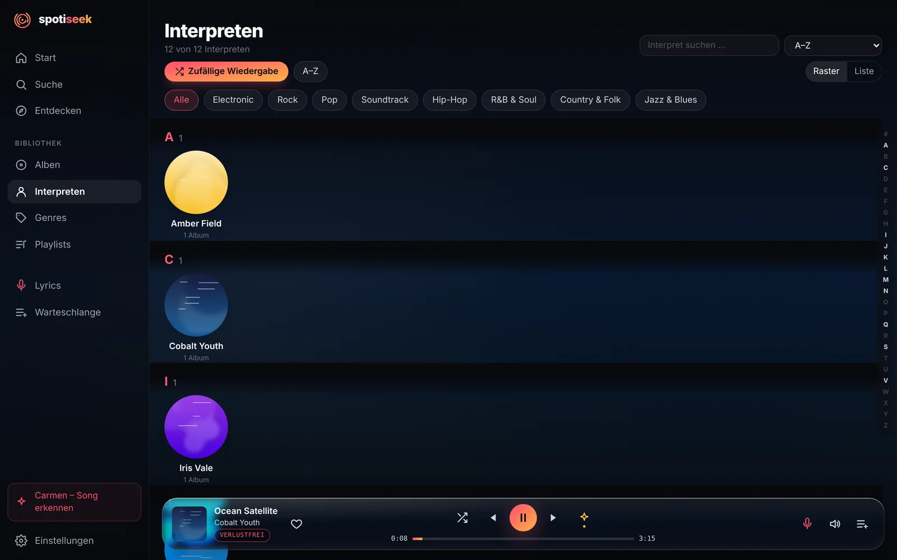
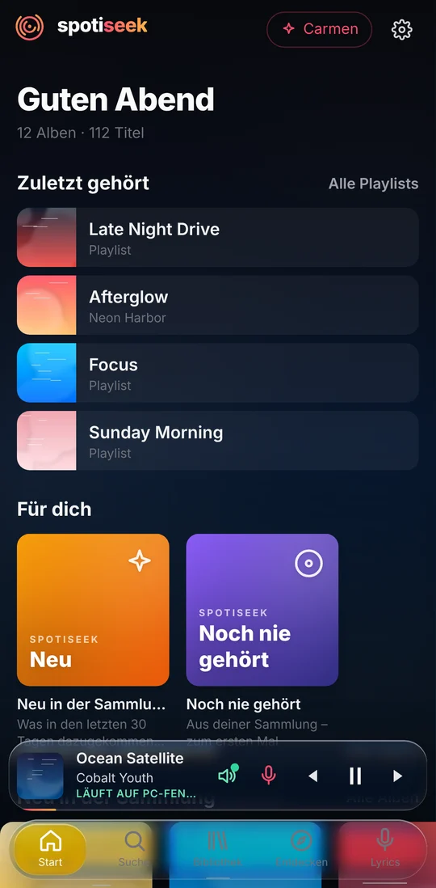
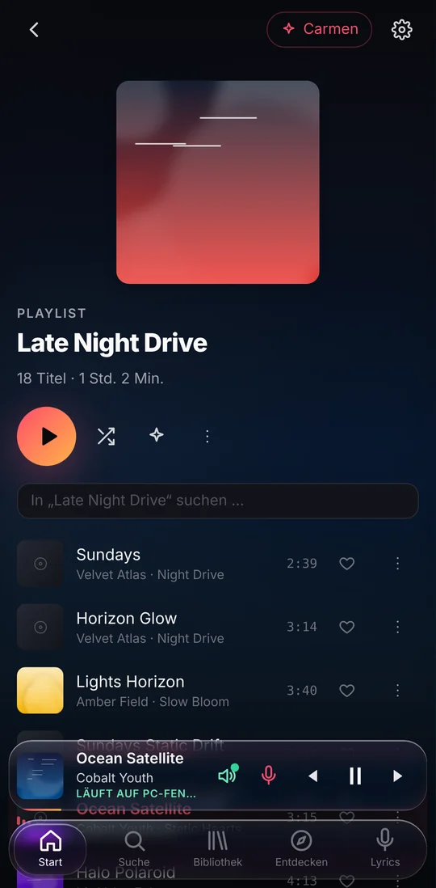

# spotiseek Player

**Your own music library, played like a streaming app – bit-perfect.**

A music player for Windows and Android that plays the files on your PC the way Spotify plays its catalogue:
a home screen made for you, smart mixes, synced lyrics, and Connect to hand playback between PC and phone.
Lossless and hi-res files reach your DAC untouched.

[**Download for Windows**](https://github.com/mmmxcix/spotiseek-player/releases/latest/download/spotiseek-setup.exe) ·
[**Download for Android (APK)**](https://github.com/mmmxcix/spotiseek-player/releases/latest/download/spotiseek-player.apk) ·
[All releases](https://github.com/mmmxcix/spotiseek-player/releases) ·
[Deutsch](README.de.md)

## Screenshots

<table>
  <tr>
    <td width="50%"></td>
    <td width="50%"></td>
  </tr>
  <tr>
    <td></td>
    <td align="center">
      
      
    </td>
  </tr>
</table>

Screenshots show a demo library with made-up artists and generated covers.

## Features

**Sound**
- **Bit-perfect on Windows** – WASAPI exclusive mode past the Windows mixer: every file at its own sample rate and bit depth, up to 24-bit/192 kHz.
- **Bit-perfect on Android** – straight to a USB DAC, without Android's resampling.
- **Quality at a glance** – FLAC 16/44.1, 24/96, MP3 320 … on every track and album, Hi-Res badges for hi-res albums.

**Your library, like a streaming app**
- Albums, artists and genres with covers, search, and sorting. Collaborations show up on every artist involved.
- **Recently played** on the home screen, **For you** mixes (On repeat, Most played, Your mix, New, Never played) and a yearly **Wrapped**.
- **Magic Shuffle** – shuffles a playlist and slips in songs from your library that fit.
- **Synced lyrics** that follow the music, plus a sing-along mode.
- Playlists as plain `.m3u8` files – other players see them too. Favourites, play history, queue.
- **Library tools** – find duplicate editions (normal, Deluxe, CD 1/2) and merge them into one, keeping the best file of every song.

**PC and phone together**
- **Connect** – like Spotify Connect: pick where the music plays, control the PC from your phone (lock screen and notification included) or the phone from your PC, and move playback between them at the same position.
- **Listen on the go** – your library away from home through an encrypted tunnel. No port forwarding, no account.
- **Offline** – download albums and playlists to the phone.
- Pair devices with a short code; every device gets its own key and can be removed again.

**Windows**
- Play/pause and skip buttons in the taskbar preview, media keys, true fullscreen.
- Updates itself in the background when idle.

## Installation

### Windows (10 / 11, 64-bit)

1. Download [`spotiseek-setup.exe`](https://github.com/mmmxcix/spotiseek-player/releases/latest/download/spotiseek-setup.exe) and run it.
2. The installer is not code-signed yet, so Windows SmartScreen may warn you: click **More info → Run anyway**.
3. On first start, choose your music folder. spotiseek reads the tags and covers. Nothing is moved or changed.

### Android

1. Download [`spotiseek-player.apk`](https://github.com/mmmxcix/spotiseek-player/releases/latest/download/spotiseek-player.apk) on your phone and open it.
2. Allow your browser to install apps when Android asks.
3. On the PC, open **Settings → Devices → Connect new device**, then enter the code in the app.

The phone streams from your PC, so the PC app must be running. At home this works over Wi-Fi; switch on **Listen on the go** in the PC settings to use it anywhere.

## FAQ

**Do I need a Spotify account or any subscription?**
No. spotiseek plays music files you already have on your PC.

**Where is my data?**
On your PC. There is no cloud and no account. The only outside connection is the optional **Listen on the go** tunnel (Cloudflare), which you can turn off.

**Which formats are supported?**
FLAC, ALAC, WAV, AIFF, MP3, AAC/M4A, Ogg/Opus and more. Files the phone can't play natively are converted to FLAC on the fly.

**What language is the app in?**
German for now.

**I found a bug or have an idea.**
Please open an [issue](https://github.com/mmmxcix/spotiseek-player/issues). A screenshot helps a lot.

---

Made by <a href="https://mmmxcix.com">mmmxcix</a>

